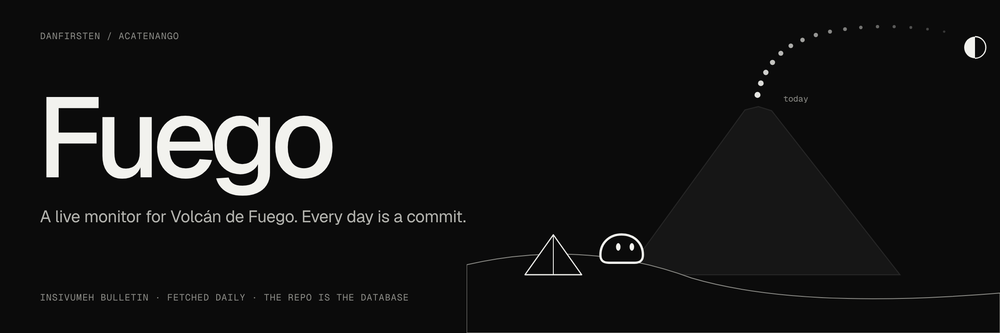

# Fuego

A monitor for **Volcán de Fuego**, Guatemala: one of the most consistently
active volcanoes on Earth, and the one that erupts across the valley while you
camp on Acatenango.

**Live site: <https://danfirsten.github.io/acatenango/>**

> **This is an unofficial archive, not a warning service.** It reads
> INSIVUMEH's daily bulletin after the fact, so it always lags the observatory.
> For alerts and current conditions, go to
> [INSIVUMEH](https://insivumeh.gob.gt) and [CONRED](https://conred.gob.gt).

## How it works

The site is a static export with no server and no database. A scheduled GitHub
Action (`.github/workflows/collect.yml`) fetches INSIVUMEH's daily volcanic
bulletin, reads it with OCR, parses it, and commits the result. **The repository
is the database**: every day is a commit, so the git history is the time series.

Fuego's bulletins are published for a short window and then rotate away, so a
field the parser fails to read today would be lost for good. Every record
therefore keeps the **raw bulletin text verbatim**, plus the `parserVersion`
that read it. The parser is a pure function of that text, so improving it means
re-running it over the archive, with no re-fetching and no data loss.

Two rules follow from that:

- **Missing is never zero.** A field the bulletin did not state is `null` and is
  shown as missing, never drawn or counted as 0. A wrong value is worse than a
  missing one.
- **The parser degrades, it does not fail.** Bulletins are written by hand and
  the phrasing drifts, so each field is read on its own. One that cannot be
  found gives `null` and a warning, and the rest of the day is kept.

## The mountain is real

The 3D view is not a sculpted or procedural mountain. `scripts/fetch-terrain.ts`
pulls [AWS Terrain Tiles](https://registry.opendata.aws/terrain-tiles/) (public
domain, SRTM-derived, no API key), decodes the terrarium elevation encoding, and
bakes a 512×512 heightmap covering 14.2 km of the Acatenango and Fuego massif at
about 28 m per pixel.

The fetch checks itself against published summit heights and refuses to write a
heightmap that does not match:

```
Fuego:      DEM 3771 m vs published 3763 m  (+8 m)
Acatenango: DEM 3967 m vs published 3976 m  (-9 m)
```

The one liberty is vertical exaggeration (×1.55), which the page discloses.

## Layout

```
scripts/fetch-terrain.ts  Bakes the elevation heightmap (run once)
scripts/collect.ts        Fetches, OCRs and archives the day's bulletin
scripts/backfill.ts       Archives past days by date
scripts/ocr.ts            Rasterises the scanned PDF and reads it with tesseract
scripts/build-index.ts    Rolls the archive into data/index.json
scripts/og.ts             Renders the social card from the static build
src/lib/parse-bulletin.ts The parser: pure, tested, versioned
src/lib/scene/massif.ts   Three.js terrain, ash plume and camera rig
data/bulletins/*.json     One record per day, raw text kept
data/index.json           Generated; what the site reads at build time
```

### Parsing notes

The bulletins are in Spanish, and Spanish prose collides with compass
abbreviations: `se` is a pronoun, `no` is a negation, `o` means "or". Spelled-out
directions are matched case-insensitively, abbreviations in capitals only, and
both only inside the dispersal clause. `Ceniza` is both a barranca on Fuego's
flank and the word for ash, so drainage names are only matched in a clause that
names barrancas. Numbers are read by shape: `4,500` and `4.500` both mean 4500,
while `1.1 km` is a decimal. Ash columns below Fuego's 3,763 m summit are
flagged as misparses, not readings.

## Development

```bash
npm install
npm test             # parser and library tests; no network needed
npm run lint
npm run typecheck    # next typegen, then tsc
npm run dev
npm run build        # static export to out/
npm run build:index  # rebuild data/index.json; warns if records are behind
npm run og           # re-render public/og.png from out/ (build first)
```

`npm run collect` needs `poppler-utils` and `tesseract-ocr` with the Spanish
language pack. `BULLETIN_URL=<url> npm run collect` fetches one specific
bulletin. Behind a proxy, use `NODE_USE_ENV_PROXY=1` (Node 22.21 or later), since
Node's `fetch` ignores `HTTPS_PROXY` otherwise.

`SITE_URL` sets the address used in the social card metadata. It defaults to the
live site above.

## Data and credits

- **Bulletins** are INSIVUMEH's work, published by the Instituto Nacional de
  Sismología, Vulcanología, Meteorología e Hidrología de Guatemala. They are
  credited on the site and their text is kept verbatim in `data/bulletins/` for
  the record. They are not covered by this repository's licence. The daily PDF
  sits at a date-addressable address, so nothing is scraped:
  `https://insivumeh.gob.gt/wp-content/uploads/{YYYY}/{MM}/BVD-{YYYY}-{MM}-{DD}.pdf`
- **Terrain** is from [AWS Terrain Tiles](https://registry.opendata.aws/terrain-tiles/),
  which is public domain.
- **Cross-checks**: the [Smithsonian Global Volcanism Program](https://volcano.si.edu)
  (Fuego is volcano `342090`) publishes weekly reports that are useful for
  checking the archive.

## Licence

The code is [MIT](LICENSE). The bulletin text belongs to INSIVUMEH, as above.
